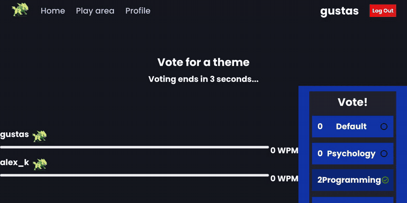

# Typefaster

**A real-time multiplayer typing race.** Join a lobby, vote on what to type, and race other people live.

### [Live demo → typefaster-gustas.duckdns.org](https://typefaster-gustas.duckdns.org)

**Try it:** open the site in two browser tabs and press **Race Now!** in both, or press **START** in a lobby to race on your own. Log in and your results are saved to your profile.



## Features

- **Live races.** Every player's progress bar and WPM update several times a second while you type.
- **Lobbies.** *Race Now!* puts you in the fullest public lobby. Private lobbies get an invite link for friends.
- **Theme voting** before each race: classic lines, psychology, programming quotes or space.
- **Accounts and stats.** Average WPM, win rate, favourite theme and your race history on your profile.
- Guests can play without an account.

## How it works

- **The server runs the game.** Each lobby is a state machine (waiting → theme vote → countdown → race → results) built from one class per state in [`server/game/GameState.js`](server/game/GameState.js). Timers live on the server, so every player sees the same countdown.
- **Clients only report progress.** The browser sends its current word index over Socket.IO. The server works out each player's percentage, WPM (from its own clock) and position, and broadcasts them to the lobby every 300 ms.
- **Results go to MySQL** when a race ends. The schema is applied automatically on startup ([`server/db/migrate.js`](server/db/migrate.js)).

## Tech stack

| | |
|---|---|
| Client | React 18, React Router, Socket.IO client, Quill, Sass |
| Server | Node.js, Express, Socket.IO, JWT (HttpOnly cookie), bcrypt |
| Database | MySQL 8 |
| Deployment | Docker multi-stage build, Docker Compose, Caddy (HTTPS) on an Azure VM |

## Run it locally

You only need Docker:

```bash
git clone https://github.com/TheMixas/Typefaster.git
cd Typefaster
docker compose up --build
```

Open http://localhost:5000 in two tabs to race yourself.

<details>
<summary><b>Development with hot reload</b></summary>

```bash
# MySQL somewhere, then:
cd server && npm install
# server/.env: DB_HOST, DB_PORT, DB_USER, DB_PASSWORD, DB_DATABASE, JWT_SECRET, NODE_ENV=development
npm run dev                      # http://localhost:5000

cd client && npm install && npm start   # http://localhost:3000, talks to :5000
```
</details>

<details>
<summary><b>Project structure</b></summary>

```
typefaster/
├── client/                 # React app (Create React App)
│   └── src/
│       ├── containers/     # pages: home, play area, game arena, profile
│       ├── hooks/useSocket.js
│       └── sockets/        # handlers for server events
├── server/
│   ├── index.js            # HTTP + Socket.IO server
│   ├── socket.js           # socket events: play, join, vote, progress
│   ├── gameManager.js      # lobbies and matchmaking
│   ├── game/               # Game, Player and the game-state machine
│   ├── routers/            # REST: auth, profiles, leaderboards
│   └── db/                 # MySQL queries, schema.sql, migrate.js
├── Dockerfile              # builds the client, then the server that serves it
└── docker-compose.yml
```
</details>
