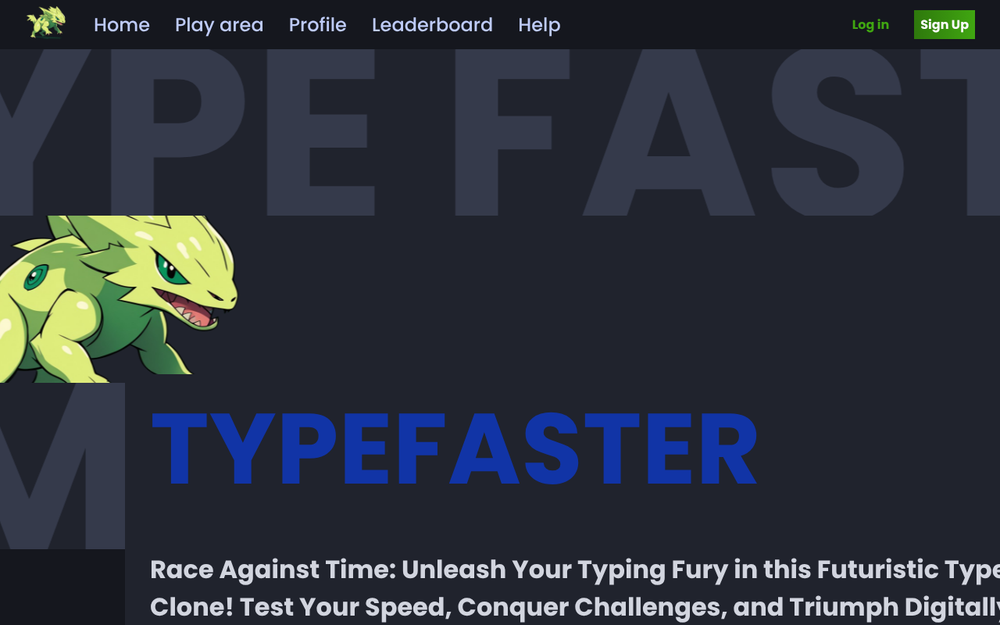

# Typefaster

**A real-time multiplayer typing race.** Join a lobby, vote on the text theme, and race other players live, watching everyone's progress bars move as they type.

### 🔴 [Live demo → typefaster-gustas.duckdns.org](https://typefaster-gustas.duckdns.org)

**Try it:** open the site in two browser tabs (or send the invite link to a friend) and press **Play** in both. You can also start a single-player race on your own. Sign up to have your results saved to your profile.



## Features

- **Live multiplayer races over Socket.IO.** The server runs the game loop and streams every player's position and WPM several times a second.
- **Matchmaking and private lobbies.** *Play* joins the fullest public lobby; private games are shared with an invite link.
- **Theme voting** before each race decides which kind of text you type.
- **Game state machine** on the server: waiting → theme voting → countdown → in progress → finished → back to lobby.
- **Accounts and stats.** JWT in an HttpOnly cookie; results go to MySQL, and profiles show games played, win rate, average WPM and favourite theme, with charts.
- Guests can play without an account; their results just aren't saved.

## Tech stack

| | |
|---|---|
| Client | React 18, React Router, Socket.IO client, Sass, Google Charts |
| Server | Node.js, Express, Socket.IO, JWT, bcrypt |
| Database | MySQL 8 (`server/db/schema.sql`, applied automatically on startup) |
| Deployment | Docker multi-stage build, Docker Compose, Caddy (automatic HTTPS) |

## Project structure

```
typefaster/
├── client/                 # React app (Create React App)
│   └── src/
│       ├── containers/     # pages: home, play area, game arena, profile
│       ├── hooks/useSocket.js
│       └── sockets/        # handlers for server events
├── server/
│   ├── index.js            # HTTP + Socket.IO server
│   ├── socket.js           # socket events: play, join, vote, progress
│   ├── gameManager.js      # lobbies / matchmaking
│   ├── game/               # Game, Player and the game-state machine
│   ├── routers/            # REST: auth, profiles, leaderboards
│   └── db/                 # MySQL queries, schema.sql, migrate.js
├── Dockerfile              # builds the client, then the server that serves it
└── docker-compose.yml
```

## Run it locally

You only need Docker:

```bash
git clone https://github.com/TheMixas/Typefaster.git
cd Typefaster
docker compose up --build
```

Open http://localhost:5000. Open it in two tabs to race yourself.

<details>
<summary><b>Development with hot reload</b></summary>

```bash
# MySQL somewhere, then:
cd server && npm install
# server/.env: DB_HOST, DB_PORT, DB_USER, DB_PASSWORD, DB_DATABASE, JWT_SECRET, NODE_ENV=development
npm run dev                      # http://localhost:5000

cd client && npm install && npm start   # http://localhost:3000, talks to :5000
```
</details>

## Author

**Gustas Rove** ([TheMixas](https://github.com/TheMixas)). See also [Ryklys](https://github.com/TheMixas/ryklys), a live-streaming platform with a C++ backend.
